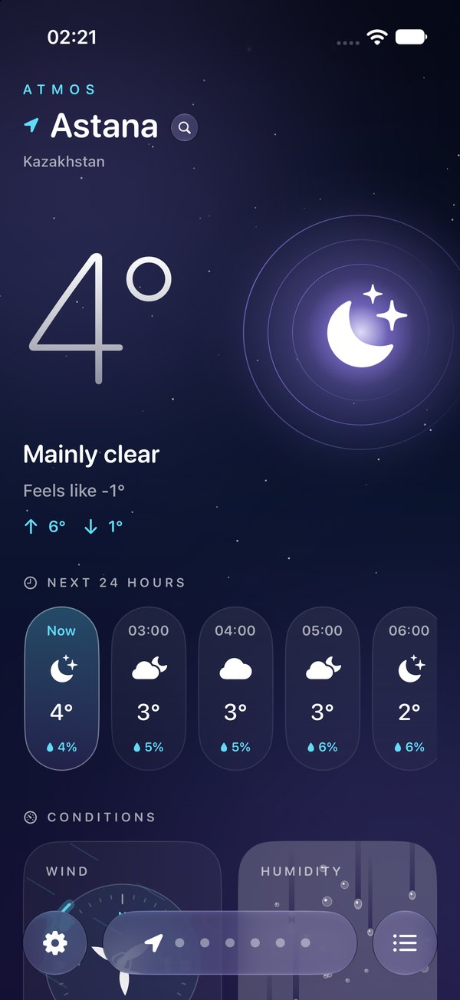
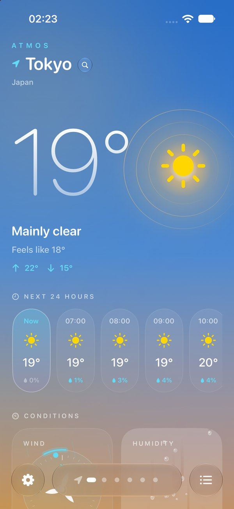
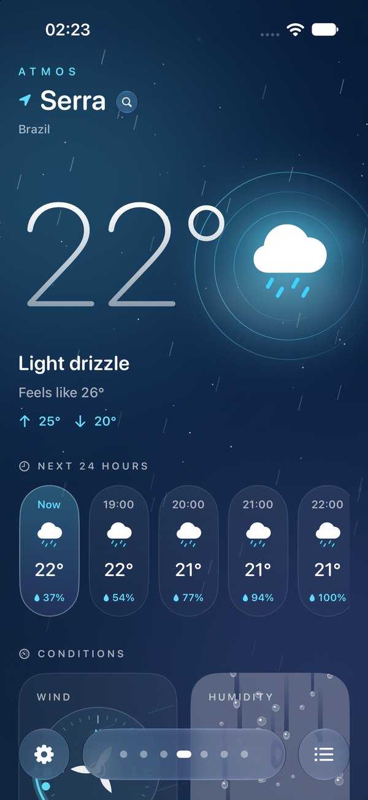
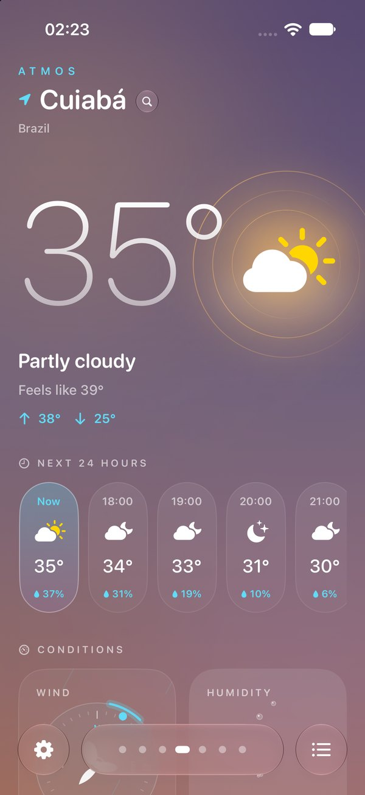
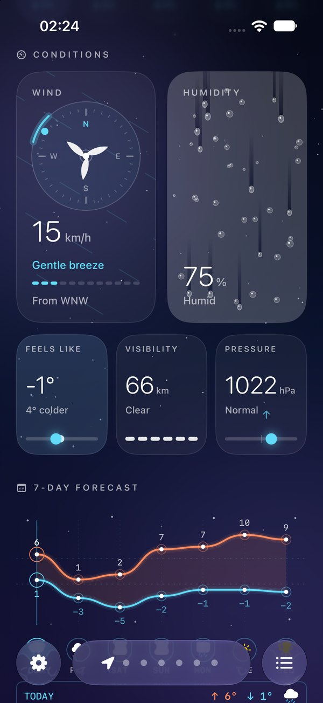
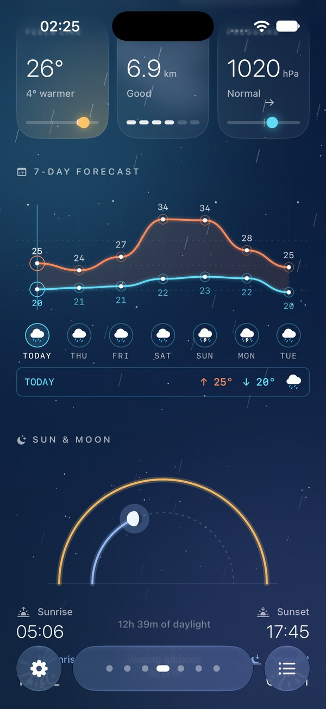
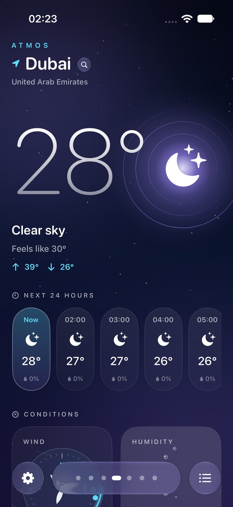
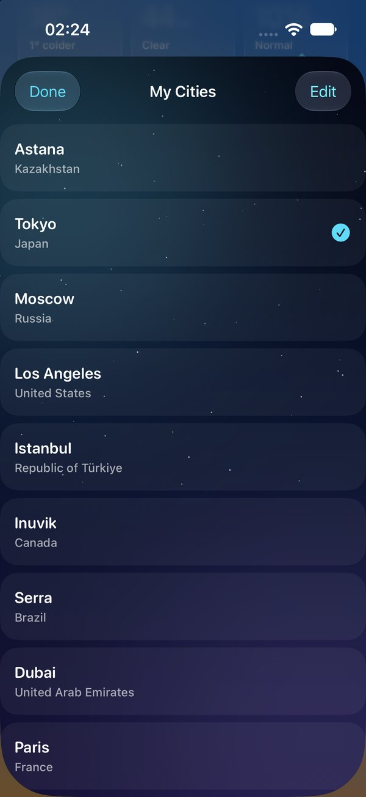
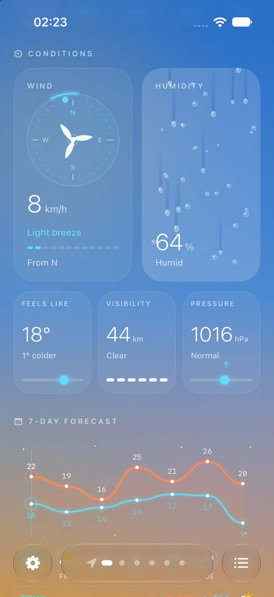
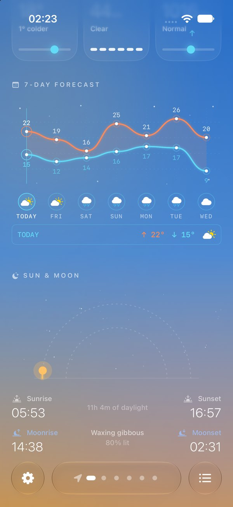

<div align="center">

# ATMOS

**A living weather app for iOS, built with SwiftUI.**

The whole screen changes with the sky: warm gradients by day, a starry night after sunset, falling rain when it drizzles.


</div>

<p align="center">
  
  
  
  
</p>

## Features

- **Atmosphere that reacts to the weather.** Background, colors and particles change with conditions and time of day: sunny gradients, night sky with stars, animated rain, frost and lightning layers.
- **Next 24 hours.** Hourly capsules with temperature, icon and chance of precipitation.
- **Conditions at a glance.** Wind compass with a spinning turbine, humidity card with falling drops, feels-like, visibility and pressure with trend.
- **7-day forecast.** Smooth high/low temperature curves with daily icons.
- **Sun & Moon.** Sun path arc, sunrise and sunset, daylight length, moonrise, moonset and moon phase.
- **Your cities.** Save cities, search for new ones, or use your current location. Swipe between them.
- **Glass bottom bar and haptics** for a tactile, native feel.

<p align="center">
  
  
  
  
</p>

<p align="center">
  
  
</p>

## Tech stack

| | |
|---|---|
| UI | SwiftUI, custom animated layers, glass materials |
| Weather data | [Open-Meteo API](https://open-meteo.com) (free, no API key) |
| Location | CoreLocation, city search and geocoding |
| Astronomy | Custom sun and moon calculations |
| Feedback | Haptics |

## Project structure

```
WeatherService.swift      networking and weather models (Open-Meteo)
Untitled Project/
  ContentView 2.swift     main screen
  ForecastWave.swift      7-day forecast curves
  ConditionCards.swift    wind, humidity, feels like, visibility, pressure
  SunMoonSection.swift    sun path and moon phase
  MoonCalc.swift          moon phase calculations
  LightningLayer.swift    weather effects
  FrostLayer.swift
  GlassBottomBar.swift    bottom navigation
  CitiesListView.swift    saved cities
  CitySearchView.swift    city search
  LocationManager.swift   current location
  AtmosGeocoder.swift     city names from coordinates
  Haptics.swift
```

## Run it

1. Clone the repo:
   ```bash
   git clone https://github.com/atobroo/Atmos.git
   ```
2. Open `Atmos.xcodeproj` in Xcode.
3. Choose an iPhone simulator and press **Run** (⌘R).

No API keys or extra setup needed.

## Author

Made by **Aidos** · [@atobroo](https://github.com/atobroo)

Weather data by [Open-Meteo](https://open-meteo.com).
